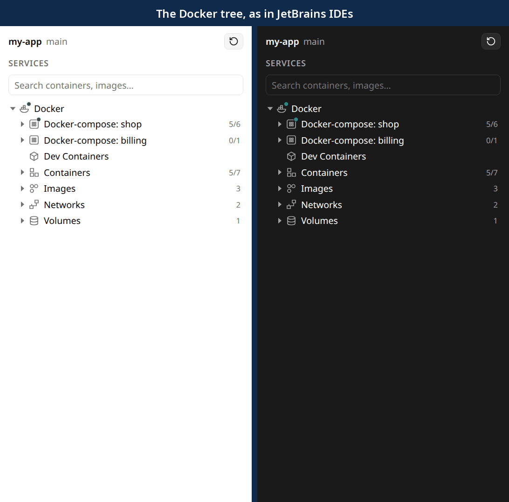

# Orca Docker plugin

Docker and Docker Compose in the Orca side panel, with crash notifications. Needs Orca 1.4.246+.

<p align="center"></p>

- Inspired by JetBrains software: follows the Docker node of the Services tool window. Independent project, not affiliated with JetBrains.
- All code in this project is AI-generated.

## Setup

```sh
npm install
npm run build
orca plugin dev load dist    # then repeat with the --approve <fingerprint> it prints
```

## Features

- **Live tree:** Compose projects, Dev Containers, Containers, Images, Networks, Volumes, with search.
- **Status dots:** green is running, red is crash-looping, unhealthy or dead.
- **Click a running container:** opens its shell in a terminal tab.
- **Right-click any row:** start, stop, restart, deploy, pause, inspect, processes, files, attach, exec, shells as root, open ports in the browser and more.
- **Dashboard:** select a container, image, network or volume to see its environment, ports, volumes, layers or users.
- **Compose:** Deploy… and Down… with options (services, profiles, env files, build, recreate, volumes), and Scale.
- **Images:** Pull with name suggestions, Create Container with run options, Push.
- **Logs in the panel:** live stream with a line filter.
- **Clean Up** on Docker, Containers, Images, Networks and Volumes: removes stopped or unused ones and the build cache. Lists what goes, then removes exactly that.
- **Create networks and volumes:** network driver picker, `--attachable` and `--internal` switches.
- **Removing an image also removes its containers.** You confirm the list first.
- **Crash notifications:** crashes, out-of-memory kills, unhealthy containers.
- **Docker contexts:** switch between the docker CLI's contexts, including TCP with TLS.
- **View options:** hide stopped containers and untagged images.

## Limitations

- No Compose profile or file picker.
- Jump to Source and Open Project are off until Orca's API can open files.
- Terminals open through the `orca-ide` CLI, because the plugin API cannot create them yet.
- SSH contexts are not supported; `DOCKER_HOST` and `DOCKER_CONTEXT` are not read, only `~/.docker` contexts.
- Commands assume a POSIX shell.

## Checks

```sh
npm test
npm run typecheck
```
